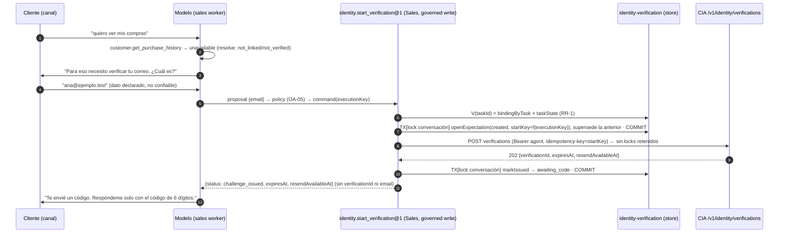
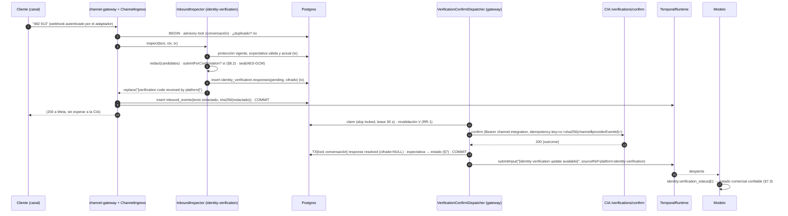

# R4-J4-SEC-OTP — Decisión de arquitectura: captura y confirmación segura del OTP

| Campo | Valor |
|---|---|
| Mandatos | `R4-J4-SEC-OTP-DESIGN-01` (diseño inicial, `dc35744`) · `R4-J4-SEC-OTP-DESIGN-OWNER-REVISION-02` (esta revisión) |
| Fecha | 2026-10-21 |
| Para | Owner de R4, owner de la CIA, owner de datos, futuro owner de la landing de registro |
| Naturaleza | **Diseño y decisiones.** Ningún cambio en código ejecutable, migraciones, workers, webhook, harness, CIA ni CP. Sin despliegue |
| Estado | **Listo para revisión del owner.** Incorpora las decisiones OA-01, OA-02, OA-06 y OA-07 del owner. Quedan las aprobaciones del §13 |
| Documentos hermanos | `R4_J4_SEC_OTP_THREAT_MODEL.md` · `R4_J4_SEC_OTP_IMPLEMENTATION_PLAN.md` · `R4_J4_RR1_BINDING_RACE_ANALYSIS.md` |
| Fuentes normativas | Contrato CIA `v1-d2` §3, §4.1, §5, §9 y §10 (CIA `7525395`) · ADR-039 · `R4_J4_R3_SEC_OTP_FOLLOWUP.md` · `R4_J4_R3_OWNER_MERGE_REPORT.md` |

```text
CIA_V1_D2_CONTRACT_UNCHANGED
CIA_COMMERCIAL_ACCOUNT_LINKING_PRESERVED
ONBOARDING_FALLBACK_DEFINED
OMNICHANNEL_OTP_DESIGN_ALIGNED
SEC_OTP_ARCHITECTURE_READY_FOR_OWNER_REVIEW
SEC_OTP_IMPLEMENTATION_NOT_STARTED
R4_HARNESS_UNCHANGED
CUSTOMER_REAL_DATA_ACCESS_BLOCKED
```

---

## 0. Resumen

**Objetivo funcional (decisión del owner).** Identificar **qué cuenta comercial PrestaShop corresponde al sujeto autenticado de un canal**. No se busca establecer una identidad maestra de una persona entre plataformas.

**La CIA conserva íntegro su contrato `v1-d2`:**
- inicio por correo (`start`, credencial `agent`);
- confirmación del OTP solo por una integración de canal (`confirm`, credencial `channel-integration`);
- búsqueda de cuenta elegible **después** del código;
- vínculo solo con correspondencia comercial elegible y no ambigua;
- grants solo por `resolve`.

Este diseño **no** introduce un estado `email_verified` ni vínculos de correo sin cuenta.

**Arquitectura: A, intercepción pre-persistencia con confirmación diferida, en tres capas.**

| Capa | Ubicación | Responsabilidad | ¿Sabe de OTP o CIA? |
|---|---|---|---|
| Punto de inspección genérico y versionado | `packages/live-ops` (infraestructura operativa, fuera del kernel) | `InboundInspector` v1. Serialización por conversación. Decisión de contenido persistible en la misma transacción que el inbound | **No** |
| Integración de verificación de identidad | Paquete nuevo `adapters/domains/identity/verification` (`@r4-adapters/identity-verification`) | Clasificación y redacción, expectativas, almacén cifrado, despachador de `confirm`, protección obligatoria | Sí |
| Capa comercial | `agents/sales` | Inicio gobernado, lectura de estado, mapeo de resultados de la CIA a tratamiento comercial (incluido `onboarding_required`) | Solo el estado, nunca el código |

El harness (`agent-kernel`, `task-runtime`, `capability-runtime`, `context-compiler`, `model-gateway`, `policy-engine`, `contracts`, `observability`) **no cambia**.

**Cambios respecto a `dc35744`:** ver §14.

---

## 1. Baseline verificado (2026-10-21, revisión 02)

| Repositorio | Mandato | Verificado | Nota |
|---|---|---|---|
| R4 | `origin/main @ 6c16999` | `6c16999` | PR #14 `OPEN`, head `dc35744` antes de esta revisión, sin comentarios |
| CIA | `main @ 7525395` | `origin/main @ 7525395` | Contrato `v1-d2` aceptado solo para interoperabilidad sintética |
| CP | `main @ bbd766e` | `origin/main @ bbd766e` | S5 integrado, no desplegado |

---

## 2. Hechos del código que condicionan el diseño

| # | Hecho | Evidencia | Consecuencia |
|---|---|---|---|
| H1 | El texto se persiste por primera vez en `recordInbound`, **antes** de buscar el binding | `ingress.ts:136-155` | La inspección ocurre entre `canonicalInboundSchema.parse` (`:137`) y la escritura |
| H2 | `conversationKey` ya está calculada en `:138` | `rollout.ts:14-16` | La protección se indexa por `(channel, conversationKey)` |
| H3 | Hashes permanentes del texto: `inbound_events.content_sha256` y `task_inputs.request_hash` (inmutable) | `ingress.ts:147`; `temporal-runtime.ts:388,408`; `0005:158` | Un hash de 6 dígitos se invierte por fuerza bruta. **Redactar antes de cualquier hash persistente** |
| H4 | `memory_entries` (append-only), `context_snapshots.compiled_context` (inmutable) y `/v1/tasks/:id/thread` conservan el texto | `temporal-runtime.ts:404-407`; `0003` | No existe "borrar después" |
| H5 | El webhook responde 200 cuando todo es durable; 500 ante fallo de infraestructura (Meta reintenta; deduplicación) | `ingress.ts:95-133`; `platform.ts:117-122` | Captura y protección dentro de la transacción del inbound |
| H6 | No hay cifrado en reposo ni KMS en el repositorio | `0003:21`; `contracts/src/memory.ts:52` | Primitivo nuevo, **fuera del Core**, en el paquete de verificación |
| H7 | `live-ops` no puede nombrar canales. Solo `production-store.ts` inserta en `inbound_events`. El Core no importa `live-ops` | `live-ops-boundaries.test.ts:39-47,66-69` | El punto de inspección no nombra canales ni OTP |
| H8 | `channel-gateway` construye `ChannelIngress` sin punto de extensión | `platform.ts:27-40,94,104-106` | Se añade una opción genérica `inspector` |
| H9 | El evento canónico ya tiene `senderRef` ("usually equal to conversationRef in 1:1 channels") | `channel.ts:15-33` | El contexto confiable distingue conversaciones directas **sin cambiar el esquema canónico** |
| H10 | El despachador de salida implementa reclamo `skip locked`, lease + `generation`, backoff y barrido dentro del gateway | `outbound.ts`; `production-store.ts:221-455` | Patrón del despachador de `confirm` |
| H11 | `temporal.submitInput` es idempotente por `(task, sourceRef, externalKey)` y despierta la tarea | `temporal-runtime.ts:346,383-416` | Reanudación sin cambiar el harness |
| H12 | `memory_entries.content.actor.role` es siempre `participant` | `temporal-runtime.ts:405` | Una entrada de plataforma se ve como texto del participante: no puede llevar autoridad (§8.4) |
| H13 | `start` usa la credencial `agent`. `confirm` es exclusivo de `channel-integration`. Ambas deben compartir `consumerId` | Contrato §5, SR-03; CIA `src/config.ts`, `verification.ts #sameContext` | Un consumidor `r4-sales`, dos credenciales (§11) |
| H14 | `resolve` ignora `sessionRef` para reutilizar el vínculo | CIA `CIA_S3_IDENTITY_RESOLUTION_REPORT.md:99` | La CIA no protege contra RR-1 |
| H15 | Solo `text` llega como texto. El resto (incluido `interactive`) llega como marcador `unsupported` con `handoff` | `inbound.ts:102-119`; `profile-v6.ts:29` | WhatsApp Flows exigiría soporte nuevo: queda fuera del camino obligatorio |
| H16 | Un vínculo **solo** lo crea `confirm` (`linked`). Un desafío consumido no se reutiliza. `resolve` sin vínculo da `not_linked`, también para "email verificado sin cuenta" | Contrato §5.2, §5.3 | Tras un onboarding hace falta **un desafío nuevo** (§7.4) |
| H17 | Hay rutas que escriben texto en una tarea **sin** pasar por `ChannelIngress` | `apps/api/src/app.ts:108,168-173,182,201,272`; `context-compiler/src/sources/platform.ts:139-141` | Inventario y bloqueos de activación (§10) |

---

## 3. Alternativas y decisión

| Alternativa | Dictamen |
|---|---|
| **A. Intercepción pre-persistencia en la infraestructura de canal, con confirmación diferida** | **Seleccionada.** OA-01 está decidido: `live-ops` es infraestructura operativa fuera del kernel. Es el único punto del código donde coinciden autenticidad del proveedor, ausencia de persistencia, identidad de conversación y deduplicación durable |
| **B. Relay externo** | **Descartada.** Custodia el `appSecret`, queda en el camino crítico de todo el tráfico, duplica deduplicación y almacén, y exige igualmente cambios en R4 para registrar expectativas y reanudar tareas. La comparación completa está en `dc35744` §3.2–3.4 y se mantiene |
| **C. WhatsApp Flows** | **Interfaz opcional posterior, fuera del camino obligatorio** (decisión del owner). No sustituye a la redacción: el cliente puede escribir el código en el chat. Si se adopta, reutilizará el almacén y el despachador. **No se activa** |

---

## 4. Frontera arquitectónica (OA-01, decidido)

**Registro de la decisión del owner:**
- `packages/live-ops` pertenece a la infraestructura operativa, fuera del kernel.
- `apps/channel-gateway` pertenece a la composición y a la infraestructura de canal.
- El harness permanece estable y agnóstico.

**Reglas que de ahí se derivan para este diseño:**

| Regla | Materialización |
|---|---|
| Solo **un** punto de inspección genérico y versionado en la ingesta | `InboundInspector` con `version: 1` (§5). Un cambio incompatible exige `version: 2` y una enmienda del ADR-040 |
| La lógica de OTP, el cifrado, la gestión de desafíos y la comunicación con la CIA quedan **fuera del núcleo reusable** | Todo vive en `@r4-adapters/identity-verification` y en `@r4-adapters/identity-http`. `live-ops` no contiene `otp`, `verification`, `cia`, `code` ni nombres de canal. Se amplía la prueba de frontera (AT-19) |
| Sin dependencias de la CIA en el Core | El Core no importa ninguno de los dos paquetes (AT-19) |
| Sin lógica de proveedor en `live-ops` | La verificación del origen sigue siendo de cada adaptador de canal (`InboundChannelAdapter.authenticate`) |

**Dirección de dependencias:**
- `@r4-adapters/identity-verification` → `@r4/live-ops` (puertos), `@r4/task-runtime` (tipo `TemporalRuntime` para reanudar) y `@r4-adapters/identity-http` (cliente `confirm`).
- Ningún paquete de `packages/` depende del paquete de verificación.

---

## 5. Puerto común de ingreso e inspección (omnicanal)

### 5.1 Contrato genérico (`packages/live-ops`)

```ts
/** Versioned, channel- and purpose-agnostic inspection point of ChannelIngress (ADR-040, R4-I.1). */
export interface InboundInspector<Tx = unknown> {
  readonly version: 1;
  readonly id: string;                                   // e.g. 'identity-verification' (composition label only)
  /** Runs INSIDE the inbound transaction, after the per-conversation lock and the duplicate check,
   *  before any persistence or hashing of the content. No network, no model, no domain owner. */
  inspect(content: InspectableContent, context: TrustedChannelContext, tx: Tx): Promise<InspectionDecision>;
  /** Whether this inspector currently has a protection obligation that forbids removing it (ADR-040 inv. 6). */
  protectionActive(tx: Tx): Promise<boolean>;
}
export type InspectableContent = { readonly kind: 'text'; readonly text: string };   // unsupported content is not inspected
export interface TrustedChannelContext {
  readonly channel: string;            // authenticated by the channel adapter
  readonly accountRef: string;
  readonly conversationRef: string;
  readonly senderRef: string;
  readonly direct: boolean;            // senderRef === conversationRef (H9)
  readonly conversationKey: string;    // HMAC (rollout.ts)
  readonly providerEventId: string;
  readonly occurredAt: string;
  readonly now: string;                // database clock inside the transaction
  readonly binding: { readonly bindingId: string; readonly taskId: string | null; readonly taskAcceptsInput: boolean } | null;
}
export type InspectionDecision =
  | { readonly kind: 'pass' }
  | { readonly kind: 'replace'; readonly text: string };   // the ONLY text that will be persisted and hashed
```

**Lo que el puerto garantiza:**
- **Agnóstico.** Ningún nombre de canal, proveedor u OTP en el puerto.
- **Contexto confiable.** Lo arma `ChannelIngress` a partir del evento ya autenticado por el adaptador y de lecturas de plataforma en la misma transacción. El inspector no recibe el cuerpo crudo ni metadatos de proveedor.
- **Efectos propios en la transacción.** El inspector solo escribe sus propias tablas a través de `tx`. La decisión `replace` reemplaza el texto **antes** de `content` y `contentSha256`.
- **Fallo cerrado.** Si `inspect` lanza una excepción, `ChannelIngress` no persiste el texto original. La regla y su mecanismo están en §9.3.

### 5.2 Responsabilidades por canal

| Canal | Adaptador en el repositorio | Autenticación del origen | Estado en este diseño |
|---|---|---|---|
| WhatsApp Cloud | `adapters/channels/whatsapp-cloud` | HMAC `x-hub-signature-256` sobre el cuerpo crudo, con pruebas (`inbound.ts:51-60`) | **Único canal implementado.** Inspección v1 aplicable |
| Instagram, Messenger | **No existe** | Responsabilidad de su adaptador futuro | **No implementado.** Sin adaptador ni pruebas no se declara soportado |
| Webchat | **No existe** | Responsabilidad de su adaptador futuro (sesión autenticada) | **No implementado.** Ver el punto de detención siguiente |
| Futuros | — | `InboundChannelAdapter.authenticate` falla cerrado | Entran por el mismo puerto sin cambios en `live-ops` ni en el inspector |

**Punto de detención: webchat y `subjectAssurance`.** El contrato de la CIA admite hoy solo `subjectAssurance: "provider_signed"` (`cia-common.v1`).
- Un webchat sin firma de proveedor necesitaría:
  - **o bien** un mecanismo de autenticación que sea equivalente a una firma de proveedor y que el owner de la CIA acepte como tal,
  - **o bien** una revisión del contrato de la CIA.
- **Esa decisión altera el contrato aceptado. No se toma aquí.** Queda registrada como dependencia (EXT-07).

**Configuración por canal en la CIA.** Cada canal nuevo exige que el owner de la CIA lo configure: `channel`, `channelAccountRefs`, `subjectRefPattern` y `minAssurance` en la allowlist del consumidor. El campo `channel` es una cadena genérica en el contrato: añadir un canal **no** cambia el contrato.

### 5.3 Reglas omnicanal de la inspección v1

- El OTP se acepta **solo en la misma conversación** donde se inició la verificación. La expectativa está ligada a `(channel, conversationKey)` y al `bindingId` del inicio.
- La captura exige `direct = true` y que `senderRef` sea el sujeto del binding (`recipientRef`). En conversaciones no directas, como un grupo, el inspector **redacta pero nunca captura**.
- `subjectRef` ante la CIA = `binding.recipientRef`, `channelAccountRef` = `binding.accountRef`, `sessionRef` = `bindingId`. No se usa ningún campo exclusivo de WhatsApp.

---

## 6. Flujo seleccionado

### 6.1 Transacción del inbound con inspector (coherencia por conversación)

```text
ChannelIngress.ingest(event)                                   (adapter ya autenticó; sin red)
  key ← conversationKey(event)
  BEGIN
    pg_advisory_xact_lock(conversationLockKey(channel, key))   ← serializa por conversación (§6.4)
    if inbound (channel, providerEventId) existe → duplicate_deliveries+1; COMMIT; return duplicate   (sin inspección)
    ctx ← TrustedChannelContext (binding abierto + taskState leídos en la TX; now = clock_timestamp())
    decision ← inspector.inspect(content, ctx, tx)               (lee expectativas; puede insertar captura cifrada)
      on throw → decision ← fail-closed (§9.3)
    text ← decision.kind = 'replace' ? decision.text : original
    insert inbound_events(content = text, content_sha256 = sha256(text), status='received', …)
  COMMIT
  #process(record)   ← camino actual: binding, submitInput(text redactado), settle
```

**Diferencia con el diseño anterior:**
- El duplicado se detecta **antes** de inspeccionar, así que una reentrega nunca captura.
- La consulta de expectativa, la captura y la escritura del inbound ocurren bajo el **mismo lock y la misma transacción**.

### 6.2 Inicio de la verificación



### 6.3 Captura, confirmación y reanudación



### 6.4 Sincronización por conversación (corrige la carrera de expectativa)

**Lock lógico.** `pg_advisory_xact_lock(conversationLockKey(channel, conversationKey))`, donde `conversationLockKey` es una función genérica de `live-ops` (un hash de 64 bits de `channel‖0x00‖conversationKey`).

**Lo toman, en transacciones cortas y siempre antes de cualquier bloqueo de fila:**
- (a) la transacción del inbound;
- (b) `openExpectation` (incluido el reemplazo);
- (c) `markIssued`;
- (d) las transiciones de cierre y expiración del barrido;
- (e) el registro del resultado del despachador.

**Ninguna transacción retiene el lock durante una llamada de red:** el `start` y el `confirm` ocurren entre transacciones.

| Carrera | Orden posible | Resultado |
|---|---|---|
| `openExpectation` ∥ inbound | Si la expectativa se confirma antes, el inbound la ve y redacta. Si el inbound se confirma antes, el mensaje es **anterior al desafío** y no puede contener su código: el correo sale después del commit de `created`, por el orden del handler | Sin ventana de fuga |
| Reemplazo (A → B) ∥ inbound con el código de A | Inbound primero: captura contra A, y luego el reemplazo cancela las respuestas `pending` de A en su transacción. Reemplazo primero: el inbound ve B en `created`, redacta, y la captura queda contra B (la CIA dará `invalid_code`) | El código de A nunca se envía después del reemplazo. El mensaje se redacta siempre |
| Expiración (barrido) ∥ inbound | La ventana de protección (`protect_until`) no depende del estado: la redacción no cambia. La captura exige `now < challenge_expires_at` con el reloj de la base en la misma transacción | Sin captura fuera de ventana |
| Resultado del despachador ∥ reemplazo | El registro del resultado toma el lock y comprueba `version` y estado. Si la expectativa ya no es la vigente, guarda el resultado en la respuesta sin tocar la expectativa nueva ni reanudar | Un resultado viejo no contamina el desafío nuevo |
| Dos inbounds simultáneos de la misma conversación | Se serializan | El orden de captura es el de commit, y `received_seq` lo refleja |

**Por qué un lock consultivo y no `SELECT … FOR UPDATE` sobre la expectativa:** cuando todavía no hay expectativa, no hay fila que bloquear. El lock por conversación cubre la apertura.

Las pruebas deterministas de estas carreras (RX-01…RX-07) están en el modelo de amenazas §4.5.

---

## 7. Estados, resultados de la CIA y onboarding

### 7.1 Expectativa: estados y transiciones

| Estado | `verification_id` | `closed_at` | Significado |
|---|---|---|---|
| `created` | **nulo** | nulo | Expectativa registrada; `start` en curso |
| `awaiting_code` | no nulo | nulo | Desafío emitido; se aceptan respuestas |
| `processing` | no nulo | nulo | Una respuesta está en manos del despachador |
| `confirmed` | no nulo | no nulo | La CIA consumió el desafío con el **código correcto** (`linked`, `no_eligible_account`, `ineligible_account`, `ambiguous`, `conflicted`) |
| `rejected` | no nulo | no nulo | `locked`, o `invalid_code` con 0 intentos |
| `expired` | **nulo o no nulo** | no nulo | `created` sin 202 antes de 600 s; o el desafío venció |
| `cancelled` | **nulo o no nulo** | no nulo | Reemplazo, binding no vigente, fallo del `start`, operador |

| ID | Transición | Disparador | Prueba |
|---|---|---|---|
| TR-01 | `created → awaiting_code` | `markIssued` (fija `verification_id`, `challenge_expires_at`) | AT-TR-01 |
| TR-02 | `created → cancelled` | Fallo terminal del `start`, reemplazo, binding no vigente | AT-TR-02 |
| TR-03 | `created → expired` | Sin 202 en 600 s (barrido) | AT-TR-03 |
| TR-04 | `awaiting_code → processing` | Reclamo del despachador | AT-TR-04 |
| TR-05 | `processing → awaiting_code` | `invalid_code` con intentos > 0, o reintento sin resultado | AT-TR-05 |
| TR-06 | `processing → confirmed` | Resultado con código correcto | AT-TR-06 |
| TR-07 | `processing → rejected` | `locked` / `invalid_code` 0 | AT-TR-07 |
| TR-08 | `processing → expired` | Resultado `expired` o `deadline_at` agotado | AT-TR-08 |
| TR-09 | `awaiting_code → expired` | Vencimiento (barrido) | AT-TR-09 |
| TR-10 | `awaiting_code → cancelled` | Reemplazo, binding no vigente, operador | AT-TR-10 |
| TR-11 | `processing → cancelled` | Reemplazo (el resultado en vuelo se registra en la respuesta) | AT-TR-11 |
| TR-12 | Cualquier terminal → cualquier otro | **Prohibida** (trigger) | AT-TR-12 |
| TR-13 | `awaiting_code` sin `verification_id`, `created` con `verification_id`, `confirmed` sin resultado | **Prohibidas** (CHECK) | AT-TR-13 |

### 7.2 Esquema corregido (migración propia del paquete de verificación, **no creada**)

El diseño anterior tenía `check ((state in ('created')) = (verification_id is null))`. Esa restricción impedía `cancelled`/`expired` sin `verification_id`, aunque TR-02 y TR-03 son legítimas. **Corregido:**

```sql
create schema identity_verification;   -- propiedad de @r4-adapters/identity-verification (como sales.* del pack)

create table identity_verification.expectations (
  expectation_id        uuid primary key,
  channel               text not null,
  conversation_key      text not null check (conversation_key ~ '^[0-9a-f]{64}$'),
  account_ref           text not null,
  binding_id            uuid not null,          -- referencia lógica a channel_conversation_bindings
  task_id               uuid not null,
  consumer_id           text not null,          -- 'r4-sales'
  start_idempotency_key text not null unique,
  verification_id       text,
  state                 text not null check (state in ('created','awaiting_code','processing','confirmed','rejected','expired','cancelled')),
  cia_outcome           text check (cia_outcome in ('linked','no_eligible_account','ineligible_account','ambiguous','conflicted','invalid_code','expired','locked')),
  attempts_remaining    smallint check (attempts_remaining between 0 and 4),
  created_at            timestamptz not null default clock_timestamp(),
  challenge_expires_at  timestamptz,
  protect_until         timestamptz not null,   -- coalesce(challenge_expires_at, created_at + 600 s) + 10 min (OA-07)
  closed_at             timestamptz,
  closed_reason         text,
  version               integer not null default 1,
  constraint created_has_no_challenge   check (state <> 'created' or verification_id is null),
  constraint issued_states_have_challenge check (state not in ('awaiting_code','processing','confirmed','rejected') or verification_id is not null),
  constraint issued_states_have_expiry  check (verification_id is null or challenge_expires_at is not null),
  constraint terminal_iff_closed        check ((state in ('confirmed','rejected','expired','cancelled')) = (closed_at is not null)),
  constraint consumed_has_outcome       check (state <> 'confirmed' or cia_outcome in ('linked','no_eligible_account','ineligible_account','ambiguous','conflicted')),
  constraint rejected_has_outcome       check (state <> 'rejected' or cia_outcome in ('locked','invalid_code'))
);
create unique index expectations_one_live on identity_verification.expectations (channel, conversation_key)
  where state in ('created','awaiting_code','processing');
create index expectations_protection on identity_verification.expectations (channel, conversation_key, protect_until);
-- trigger: un estado terminal es definitivo (TR-12); protect_until solo puede crecer.

create table identity_verification.responses (
  response_id             uuid primary key,
  expectation_id          uuid not null references identity_verification.expectations(expectation_id),
  channel                 text not null,
  provider_event_id       text not null,
  received_seq            bigint generated always as identity,
  state                   text not null check (state in ('pending','dispatching','resolved','notified','cancelled','failed','expired')),
  code_ciphertext bytea, code_iv bytea, code_tag bytea, key_id text,
  confirm_idempotency_key text not null unique,
  attempts                integer not null default 0,
  next_attempt_at         timestamptz not null default clock_timestamp(),
  lease_owner text, lease_generation bigint not null default 0, lease_expires_at timestamptz,
  cia_outcome text, failure_code text,
  deadline_at             timestamptz not null,
  purge_after             timestamptz not null,
  unique (channel, provider_event_id),
  constraint secret_only_while_open check ((state in ('pending','dispatching')) = (code_ciphertext is not null)),
  constraint sealed_fields_together check (num_nulls(code_ciphertext, code_iv, code_tag, key_id) in (0, 4))
);
```

**Cambio de propiedad.** Las tablas pasan de `public` (propuesta anterior en `persistence-postgres`) a un esquema propio del paquete de verificación, con migraciones propias, como el pack Sales con `sales.*`.
- `live-ops` y `persistence-postgres` solo aportan el lock genérico y la transacción del inbound (§6.1).
- Ninguna tabla del paquete usa claves foráneas hacia tablas de la plataforma: las referencias son lógicas, validadas por `V` (RR-1).

### 7.2b Almacenamiento transitorio del código

**Dónde existe el código:**

| Lugar | ¿Código? |
|---|---|
| Memoria del gateway, durante `inspect` y durante un intento del despachador | Sí, en claro; variable local, nunca en logs ni errores |
| `identity_verification.responses.code_ciphertext` | Solo cifrado y solo en `pending`/`dispatching` (CHECK `secret_only_while_open`) |
| `inbound_events`, `task_inputs` (con `request_hash`), `memory_entries`, `context_snapshots`, `observations`, `action_*`, `agent_run_steps`, telemetría | **No**: texto redactado y sus hashes |
| `identity_verification.expectations` | No: `verification_id` (inútil sin el código) y metadatos |
| CIA | Solo `HMAC(clave, verificationId‖código)` (SR-05) |
| CP | Nunca |

**Cifrado y claves:**

| Aspecto | Política |
|---|---|
| Algoritmo | AES-256-GCM (`node:crypto`), IV aleatorio de 96 bits, tag de 128 bits; sin dependencias nuevas. Vive en el paquete de verificación, **no** en el Core |
| Texto plano | Exactamente 6 dígitos ASCII normalizados |
| AAD | `response_id ‖ expectation_id ‖ channel ‖ provider_event_id` |
| Claves | `R4_PROD_VERIFICATION_CODE_KEYS` (`key_id:base64(32 bytes)`, la primera cifra, todas descifran). Rotar = añadir una clave al frente y retirar la anterior tras 20 min |
| Separación | Distinta de `R4_PROD_IDENTITY_HASH_KEY`. **Solo** el gateway la recibe. El sales worker, la API y el scheduler no |
| Sintético | Claves generadas por la prueba. La custodia productiva es OA-10 |

**TTL, borrado y acceso:**
- **TTL y borrado.** El cifrado se borra en la misma sentencia que saca la respuesta de `pending|dispatching` (CHECK). El barrido expira al vencer `deadline_at` y borra las filas tras `purge_after` (24 h, la retención de la clave de idempotencia de la CIA).
- **Protección ante reintentos.** `unique (channel, provider_event_id)` y la `confirm_idempotency_key` determinista impiden capturar o confirmar dos veces.
- **Acceso.** Solo el paquete de verificación lee y escribe su esquema. Ninguna ruta de la API ni `ProductionStore.thread()` lo lee. Separar roles de base de datos queda para OA-10.

**Exclusión de trazas y volcados:**
- El inspector y el despachador nunca registran el evento, el texto ni el código; los errores se registran como `{name, code}`, como en `platform.ts:120`.
- Los errores de `pg` (`detail` con "Failing row contains…") solo pueden contener texto redactado o cifrado, porque la redacción ocurre antes de todo `INSERT`.
- Los volcados de diagnóstico del harness y del evaluador leen memoria conversacional, que no contiene el código.

### 7.3 Matriz de resultados de la CIA y tratamiento comercial

El **paquete de verificación registra** el resultado de la CIA. La **capa comercial de R4** (Sales) lo traduce a un estado comercial **leído de la plataforma**, nunca de texto ni de argumentos del modelo, mediante `identity.verification_status@1` (lectura, sin argumentos de contexto, con revalidación `V` de RR-1).

| `confirm.outcome` (CIA) | Expectativa | Estado comercial (Sales) | `customerRef` / grant | Customer Profile | Respuesta comercial | ¿Onboarding? |
|---|---|---|---|---|---|---|
| `linked` | `confirmed` | `account_linked` | **No** directamente. Solo `resolve` posterior (ADR-039) | Solo vía `customer.*` → `resolve` = `verified` | Continuar. Los datos privados se piden con `customer.*` | No |
| `no_eligible_account` | `confirmed` | **`onboarding_required`** | No | **No** | Ofrecer registro mediante la landing futura (§7.4) | **Sí** (ofrecer, nunca redirigir automáticamente) |
| `ineligible_account` | `confirmed` | `account_not_eligible` | No | No | Explicar que la cuenta no permite el acceso. Ofrecer atención humana según la política del pack | **No** |
| `ambiguous` | `confirmed` | `account_ambiguous` | No | No | Atención humana. Nunca elegir una cuenta | **No** |
| `conflicted` | `confirmed` | `link_conflicted` | No | No | Atención humana | **No** |
| `invalid_code` (n > 0) | `awaiting_code` | `code_rejected` (`attemptsRemaining = n`) | No | No | Pedir el código de nuevo | No |
| `invalid_code` (0) / `locked` | `rejected` | `verification_locked` | No | No | Nueva verificación más tarde (límites de la CIA) | No |
| `expired` | `expired` | `verification_expired` | No | No | Ofrecer un desafío nuevo | No |
| — (R4 no envió: varios candidatos, contexto, longitud) | sin cambio | `code_needed` | No | No | Pedir **solo** el código de 6 dígitos | No |
| — (TTL agotado con la CIA no disponible) | `expired` | `verification_unavailable` | No | No | Reintentar más tarde | No |

| `resolve.status` (CIA, por invocación) | Tratamiento comercial | ¿Onboarding? |
|---|---|---|
| `verified` | Acceso con el grant de esa invocación | No |
| `not_linked` | `verification_needed`: ofrecer verificar el correo | **No.** `onboarding_required` **nunca** se infiere de un `not_linked` aislado: también significa "sin vínculo", "vínculo revocado" o "cuenta desaparecida" (contrato §5.3) |
| `not_verified` | `verification_needed` | No |
| `ambiguous` / `conflicted` | Atención humana | No |
| `not_authorized` | Sin acceso | No |

**Contrato de la transición** (capa comercial, `agents/sales`):

```ts
/** Commercial reading of the platform-recorded CIA outcome. Never an authority: it grants nothing. */
export type CommercialVerificationStatus =
  | { status: 'none' }                                         // no expectation for this binding
  | { status: 'in_progress'; expiresAt: string }
  | { status: 'code_needed' } | { status: 'code_rejected'; attemptsRemaining: number }
  | { status: 'account_linked' }                                // next step: customer.* → resolve
  | { status: 'onboarding_required'; onboarding: { available: boolean } }
  | { status: 'account_not_eligible' } | { status: 'account_ambiguous' } | { status: 'link_conflicted' }
  | { status: 'verification_locked' } | { status: 'verification_expired' } | { status: 'verification_unavailable' };
// Mapping (pure, Sales-owned): confirm.outcome = 'no_eligible_account' ⇒ 'onboarding_required'. No other input produces it.
```

**Invariantes de `onboarding_required`:**
- No lleva `customerRef`, grant, email ni `verificationId`.
- No habilita Customer Profile.
- No crea ninguna cuenta.
- Nace solo de `confirm.outcome = no_eligible_account` registrado para el **binding y la tarea vigentes**.
- Su vida es la de la expectativa. **No** es un estado `email_verified` y no se reutiliza en otro binding.

### 7.4 Onboarding (flujo externo) y vuelta a la CIA

- **La landing es un flujo externo** de creación de cuenta, con contrato y owner propios (EXT-05).
  - Este diseño **no inventa la URL** y no implementa la página.
  - Hasta que exista su contrato, `onboarding.available = false`, y la respuesta comercial informa que todavía no existe un registro disponible desde el chat: sin enlace, sin redirección y sin prometer disponibilidad (OA-12, decidido en ACCEPTANCE-03).
  - Cuando exista, la URL la entregará la configuración del pack, sujeta al contrato de la landing.
- **La landing nunca recibe** el código, el `verificationId`, el grant ni un `customerRef`.
  - Que reciba el email declarado o un identificador de conversación es una decisión de su contrato y de la política de datos (OA-04), no de este diseño.
- **Sin redirección automática.** El agente ofrece y el cliente decide. Ante `ineligible_account`, `ambiguous` o `conflicted` **no** se ofrece onboarding.
- **Tras registrar la cuenta, hace falta una nueva resolución autorizada por la CIA.**
  - Por H16, el contrato vigente solo crea vínculos en `confirm`, y el desafío anterior quedó consumido.
  - Por lo tanto el cliente debe **iniciar un desafío nuevo y confirmar un OTP nuevo**. Luego `resolve` emite el grant.
  - R4 **no** asume que la evidencia consumida en el desafío anterior conceda acceso, ni guarda "email verificado".
  - Si en el futuro la CIA ofreciera revincular sin OTP, sería una revisión de su contrato, fuera de este diseño.

---

## 8. Clasificación y redacción (OA-07, decidido para el alcance sintético)

### 8.1 Dos decisiones separadas

```text
redact(candidate)                 — protección: ¿puede este texto llegar al modelo o a la persistencia? (amplia, fail-closed)
submitForConfirmation(candidate)  — autoridad: ¿se gasta un intento en la CIA con este número? (estrecha, fail-safe)
```

`submitForConfirmation ⇒ redact`. **Nunca al revés.**

### 8.2 Reglas

**Período de protección.** Una conversación está protegida si existe cualquier expectativa suya con `now < protect_until`, en **cualquier** estado.
- `protect_until = coalesce(challenge_expires_at, created_at + 600 s) + 10 min`.
- Durante ese período **ningún candidato llega al modelo**, aunque el desafío ya esté confirmado, expirado o reemplazado.

**Normalización** (solo para detectar; se persiste el texto original con los candidatos sustituidos):
1. NFKC;
2. dígitos `\p{Nd}` a su valor ASCII;
3. eliminar `\p{Cf}` y las marcas de keycap (`U+FE0F`, `U+20E3`);
4. separadores admitidos dentro de un candidato: `\p{Zs}`, `-`, `‐`, `–`, `—`, `.`, `·`, `/`, `_`, `,`.

**Candidato:** una corrida maximal de dígitos con a lo sumo un separador entre dígitos consecutivos, con **4 a 8 dígitos** en total.

**`redact`.** Con protección vigente, **todo** candidato se sustituye. Corridas de 9 dígitos o más (teléfonos, RUT) no son candidatos y no se tocan.

**`submitForConfirmation`.** Se envía a la CIA solo si se cumplen **todas** estas condiciones:
1. Existe una expectativa **válida**: `created`, `awaiting_code` o `processing`; binding de la expectativa = `ctx.binding.bindingId`; `ctx.binding.taskAcceptsInput`; `now < challenge_expires_at` (o `created`).
2. La conversación es directa (`ctx.direct`) y `senderRef = binding.recipientRef`.
3. El mensaje tiene **exactamente un** candidato.
4. El candidato tiene **exactamente 6** dígitos ASCII tras normalizar.
5. El mensaje es **"solo código"**: al quitar el candidato, el resto contiene únicamente puntuación, emojis y palabras de la **lista permitida** `CODE_CONTEXT`.
   - Propuesta OA-07b: `mi`, `el`, `la`, `es`, `código`, `codigo`, `cod`, `clave`, `otp`, `de`, `verificación`, `verificacion`, `aquí`, `aqui`, `va`, `te`, `lo`, `envío`, `envio`, `mando`, `paso`, `hola`, `gracias`, `ok`, `listo`, `este`, `ese`, `sería`, `seria`, `is`, `my`, `code`, `here`.
   - Cualquier otra palabra (`pedido`, `orden`, `monto`, `total`, `$`, `rut`, `fono`, `y quiero…`) **excluye** el envío.
   - Es una lista **permitida**, no una lista de bloqueo: lo desconocido no se envía.

**Si no se envía,** el candidato igualmente se redacta y el marcador pide **solo** el código. **No se consume ningún intento** en la CIA.

### 8.3 Marcadores (texto de plataforma persistido; sin dígitos, email ni identificadores)

| Marcador | Cuándo |
|---|---|
| `[verification code received by platform]` | Candidato redactado **y** enviado |
| `[number withheld by platform: identity verification in progress; ask the customer to send only the 6-digit code]` | Candidato redactado y **no** enviado (varios candidatos, contexto, longitud distinta de 6, expectativa no válida) |
| `[message withheld by platform: identity verification in progress]` | Fallo cerrado: se reemplaza **todo** el mensaje (§9.3) |
| `[quoted platform marker removed]` | El cliente escribió el texto de un marcador (se neutraliza siempre, haya o no protección) |
| `[identity verification update available]` | Entrada de reanudación del despachador. **No** lleva el resultado. El modelo lo lee con `identity.verification_status@1` |

### 8.4 Por qué el marcador de reanudación no lleva el resultado

`memory_entries` registra toda entrada como `participant` (H12), así que un cliente podría imitar el texto.
- Con el resultado fuera del marcador, el modelo **siempre** consulta el estado confiable.
- Un marcador falsificado solo provoca una lectura que devuelve el estado real.
- La autoridad sigue en la CIA: `customer.*` exige `resolve` por invocación.

### 8.5 Casos de prueba de referencia (extracto de AT-02)

| Texto, con protección vigente | Persistido | Enviado |
|---|---|---|
| `482913` · `482 913` · `482-913` · `４８２９１３` · `٤٨٢٩١٣` · `4️⃣8️⃣2️⃣9️⃣1️⃣3️⃣` | `[verification code received by platform]` | Sí |
| `mi código es 482913` · `Código: 482-913, gracias` · `hola, el código es ４８２９１３` | Candidato → marcador "received" | Sí |
| `mi pedido es 482913` · `pedido 482913` · `orden #482913` | Candidato → marcador "withheld" | **No** (`pedido` y `orden` no están permitidos) |
| `$482.913` · `total 482913` | → "withheld" | **No** |
| `482913 y quiero 3 sacos` | `[…withheld…] y quiero 3 sacos` | **No** (palabras no permitidas). El `3` no es candidato |
| `pedido 123456 código 482913` | Ambos → "withheld" | **No** (dos candidatos) |
| `48291` · `4829135` | → "withheld" | **No** (longitud) |
| `+56 9 1234 5678` · `12.345.678-9` (9 dígitos o más) | Sin cambios | No |
| Mensaje en un grupo (`senderRef ≠ conversationRef`) con `482913` | → "withheld" | **No** |
| Cualquier texto **sin** protección vigente (`482913`, `pedido 123456`) | Sin cambios (N-08) | No |

**Costo comercial aceptado (OA-07):** durante la protección (≤ 20 min), un número de pedido o un monto de 4 a 8 dígitos no llega al modelo, y el agente pide repetirlo cuando termine la verificación.

---

## 9. ADR-040 (propuesta corregida): R4-I.1 y protección obligatoria

### 9.1 Texto propuesto

> **R4-I.1 — Punto de inspección de la ingesta.** `ChannelIngress` admite un único inspector genérico y versionado (`InboundInspector` v1), configurado por composición. Con un inspector configurado se cumplen estas invariantes:
>
> 1. **Inspección previa.** La inspección ocurre antes de cualquier persistencia conversacional (`inbound_events.content`, `task_inputs`, `memory_entries`) y antes de calcular cualquier hash persistente del contenido (`content_sha256`, `request_hash`).
> 2. **Sin llamadas externas en el webhook.** Ni la ingesta ni el inspector hacen llamadas de red ni invocan modelos ni servicios de dominio dentro de la petición. Todo efecto externo lo ejecuta un componente asíncrono.
> 3. **Aislamiento de secretos.** Un secreto capturado solo existe sellado, en almacenamiento propio del componente de integración, y solo lo descifran componentes fuera del agente. El proceso que ejecuta modelos y capacidades no tiene ni las claves ni las credenciales.
> 4. **Coherencia transaccional.** La lectura del estado que motiva la inspección, los efectos propios del inspector y la escritura del inbound ocurren en una transacción serializada por conversación. Un duplicado del proveedor se detecta antes de inspeccionar.
> 5. **Fallo cerrado.** Si el inspector tiene una obligación de protección vigente para la conversación y no puede decidir con seguridad, el contenido se reemplaza entero por un marcador de plataforma. Si la transacción no puede completarse, nada se persiste y el proveedor reentrega.
> 6. **Protección no desactivable.** Mientras un inspector declare una obligación de protección vigente, no puede retirarse de la composición ni ponerse en un modo que persista el contenido sin tratamiento. No existe un override para eso.
> 7. **Omnicanalidad.** El puerto, el contexto y las decisiones no contienen nombres de canal ni de proveedor. La autenticidad del origen sigue siendo responsabilidad de cada `InboundChannelAdapter`. Un canal nuevo solo requiere su adaptador autenticado.
>
> Sin inspector configurado y sin obligaciones de protección vigentes, la ingesta es idéntica a R4-I.

### 9.2 Modos del componente de verificación (sin `FORCE_OFF`)

| Modo | Inicio de verificaciones | Captura | Despacho a la CIA | Redacción | Cuándo |
|---|---|---|---|---|---|
| `full` | Sí (si el pack registra la capacidad) | Sí | Sí | Sí | Operación normal sintética |
| `protect_only` | **No** | **No** (los candidatos se redactan sin sellar) | No (las respuestas `pending` se cancelan y su cifrado se borra) | **Sí** | Apagado de verificaciones, emergencia, o falta de la clave o la credencial |
| `absent` (sin inspector) | No | No | No | No | **Solo** si `protectionActive()` = falso para todas las conversaciones |

**Separación del apagado:**
- Desactivar el **inicio** de verificaciones es una decisión del pack (quitar o bloquear `identity.start_verification`).
- Desactivar la **protección** solo es posible cuando ya no queda ninguna ventana vigente.

**Guardia de composición:**
- El gateway **no arranca** sin inspector si existe el esquema `identity_verification` con alguna `protect_until > now()`.
- No hay variable que lo omita.
- La guardia se ejecuta en la composición del gateway, para que funcione aunque el paquete no se componga.

### 9.3 Recuperación ante fallos

| Fallo | Comportamiento |
|---|---|
| El inspector lanza una excepción con protección vigente (determinada en la transacción) | Se reemplaza el mensaje entero por `[message withheld …]`; sin captura. Telemetría `inbound.inspection_failed_closed` con `{inspector, code}` |
| El inspector lanza antes de determinar si hay protección | Se aborta la transacción y el webhook responde 500. Meta reentrega y no se persiste nada. Si el fallo persiste, ver la fila siguiente |
| Fallo persistente del inspector | Las reentregas siguen dando 500. La alerta pide pasar a `protect_only`, que no necesita claves ni la CIA, solo lecturas. Si el fallo es de la base de datos, la ingesta entera está caída igual que hoy |
| Postgres no disponible | Comportamiento actual: 500 y reentrega. Nada se persiste en ninguna parte |
| Falta la clave de cifrado o la credencial `confirm` al arrancar | El gateway arranca en `protect_only`, nunca en `absent` |
| Error al descifrar | Respuesta `failed(decrypt_failed)` + alerta, sin llamar a la CIA |

---

## 10. Entradas alternativas a la ingesta (inventario y bloqueos)

| # | Ruta | Escribe en | ¿Pasa por el inspector? | Quién la usa | Clasificación |
|---|---|---|---|---|---|
| E-1 | `POST /v1/channels/:channel/webhook` → `ChannelIngress` | `inbound_events`, `task_inputs`, `memory_entries` | **Sí** | Proveedor de canal autenticado | Protegida |
| E-2 | `POST /v1/tasks/:id/inputs` (`apps/api/src/app.ts:168-173`; comentario "Canonical inbound input (any channel adapter)") | `task_inputs`, `memory_entries` (vía `submitInput`) | **No** | Cualquier principal autenticado de la API | **BLOQUEO DE ACTIVACIÓN BA-01.** Es una ruta de canal equivalente sin protección. Antes de activar: deshabilitarla en producción para tareas con binding de canal, o aplicarle una protección equivalente (cambio en `apps/api`, no en el harness, con mandato propio) |
| E-3 | `POST /v1/tasks` (`app.ts:108`): `request.input` entra al contexto (`context-compiler/src/sources/platform.ts:55`) | `agent_tasks.input` y contexto | No | API (las tareas de canal las crea `ConversationTaskFactory`) | **BLOQUEO CONDICIONAL BA-02.** Solo un operador con un código obtenido fuera de R4 podría introducirlo. Activación: procedimiento de operador + aceptación expresa del owner, o protección equivalente |
| E-4 | `POST /v1/human-requests/:id/respond` (`app.ts:201`): el texto humano entra al contexto (`platform.ts:139-141`) | `human_requests` y contexto | No | Operador autenticado (OIDC) | **BLOQUEO CONDICIONAL BA-03** (como BA-02) |
| E-5 | `POST /v1/tasks/:id/handoff` (`app.ts:182`), nota de takeover o release, en el contexto | `human_requests` y contexto | No | Operador | **BLOQUEO CONDICIONAL BA-04** (como BA-02) |
| E-6 | `POST /v1/tasks/:id/operator-messages` (`app.ts:272`; `operator.ts:72`) | `outbound_messages` (salida al cliente) | No | Operador | **BLOQUEO CONDICIONAL BA-05.** El texto va al cliente, pero queda persistido y en la proyección de interacción. Como BA-02 |
| E-7 | `POST /v1/outbound/:id/resolve` y `…/cancel` (notas) | `outbound_*` | No | Operador | Riesgo bajo (notas operativas). Incluido en el procedimiento de BA-02 |
| E-8 | Harness de Sales y shadow (`agents/sales/src/harness/runtime.ts:226`; `shadow/executor.ts:40-41`): `submitInput` en proceso | `task_inputs`, `memory_entries` | No | Pruebas y corpus sintético | No es una ruta productiva. **Condición:** el shadow nunca se alimenta con tráfico real sin pasar por la ingesta protegida (BA-06) |

**Ninguna de estas rutas se modifica en este mandato.** Los bloqueos BA-01 a BA-06 forman parte del gate de activación real (§13).

---

## 11. Credenciales de la CIA (OA-06, decidido)

- **Un único consumidor lógico `r4-sales`, con dos credenciales:**
  - `agent`: `identity.verification.start`, `identity.resolve` e `identity.link.revoke`. La usan el sales worker (`start` y `resolve`).
  - `channel-integration`: **solo** `identity.verification.confirm`. Solo la tiene el proceso `channel-gateway`.
- Coincide con la implementación de la CIA (`#sameContext` compara `consumerId`; `validateConfig` impone la exclusividad).
- **Solicitud CIA-CLAR-01 al owner de la CIA** (no se modifica la CIA ni sus artefactos normativos):
  - El contrato `v1-d2` §2 lista como ejemplo "`r4-sales` (agent), `r4-sales-channel` (channel-integration)", como si fueran **dos consumidores**. Con esa configuración todo `confirm` respondería `invalid_code`.
  - Se pide aclarar en el texto normativo que se trata de **un consumidor con dos credenciales de distinto `kind`**.
  - De paso, se pide incorporar AMEND-S1-01 al texto de §4.1 (orden de los límites de tasa).

---

## 12. Invariantes preservados

| Invariante | Cómo se preserva |
|---|---|
| El kernel R4 no conoce OTP | Ningún cambio en los paquetes del harness. `live-ops` solo gana un puerto genérico sin términos de OTP (AT-19) |
| El modelo no ve el OTP | `redact` antes de cualquier persistencia o hash. Ninguna capacidad recibe ni devuelve código o `verificationId`. El sales worker no tiene clave ni credencial `confirm` |
| El webhook no llama síncronamente a la CIA | El inspector solo hace SQL en la transacción del inbound (AT-07) |
| La CIA conserva la autoridad | R4 transporta un código normalizado. No compara ni guarda hashes del código |
| R4 no certifica identidad | `account_linked` y `onboarding_required` son lecturas comerciales. El acceso exige `resolve` por invocación |
| CP no recibe códigos | El despachador solo habla con la CIA |
| Grants por invocación; `CustomerAccessGrant` opaco | Sin cambios (ADR-039) |
| Ningún código en persistencia conversacional | §7.2b, más el barrido AT-12 |
| Contrato CIA `v1-d2` sin cambios | Ninguna operación, campo ni estado nuevo en la CIA. Sin `email_verified`. Webchat sin firma queda detenido (EXT-07) |
| Sin datos reales | `R4_CUSTOMER_MODE=real` rechazado. Capacidades solo en la composición sintética. BA-01 a BA-06 bloquean la activación real |

---

## 13. Decisiones del owner y aprobaciones pendientes

| ID | Decisión | Estado |
|---|---|---|
| OA-01 | Frontera: `live-ops` y `channel-gateway` fuera del kernel; solo un punto de inspección genérico | **Decidido** (revisión 02) |
| OA-02 | ADR-040 R4-I.1 con 7 invariantes (§9.1) | **Decidido el contenido.** El archivo ADR-040 se redacta en SEC-S3 |
| OA-03 | A seleccionada; B descartada; C opcional posterior | **Decidido** |
| OA-04 | Política de datos personales del email (E1 frente a E2) y qué recibe la landing | **Decidido** (`R4-J4-SEC-OTP-OWNER-ACCEPTANCE-03`): E1 permitido **solo sintético**. Los correos reales requieren la decisión D7 |
| OA-05 | Política de `identity.start_verification@1` (autónoma o con aprobación; frecuencia) | **Decidido** (ACCEPTANCE-03): inicio autónomo gobernado, **solo** ante intención explícita del cliente, con correo declarado y binding vigente. Sin correos preventivos. Respeta los límites de la CIA, una expectativa activa por conversación y la idempotencia |
| OA-06 | Un consumidor y dos credenciales | **Decidido.** Pendiente CIA-CLAR-01 (owner de la CIA) |
| OA-07 | 4 a 8 dígitos; normalización; 6 dígitos ASCII para enviar; gracia de 10 min; captura solo con expectativa válida; nada al modelo en la protección; sin envío automático de números ambiguos | **Decidido** (sintético) |
| OA-07b | Contenido exacto de la lista permitida `CODE_CONTEXT` (§8.2) | **Decidido** (ACCEPTANCE-03): la lista propuesta, **solo para implementación y validación sintética**, sin ampliaciones implícitas. Validar que pedidos, montos y mensajes ambiguos se redacten sin consumir intentos (SEC-S1) |
| OA-08 | Texto exacto de los marcadores (§8.3) | **Decidido** (ACCEPTANCE-03): los marcadores de la revisión 02. El de reanudación no lleva resultados autoritativos |
| OA-09 | Gate RR-1: residuos aceptables y si `humanOwned` invalida la asociación | **Parcial** (ACCEPTANCE-03): RR-1 **sigue pendiente de cierre**. Para operaciones de identidad nuevas, `humanOwned` vuelve **no apta** la asociación. Verificado: `ProductionStore.taskState()` ya expone `humanOwned` (`TaskStateFacts`, `packages/live-ops/src/ports.ts:124,312`; handoff `requested` o `active`, `production-store.ts:655-665`), así que la regla se aplica sin tocar el harness |
| OA-10 | Custodia productiva de claves, roles de base de datos, revisión de nginx y PM2 | Pendiente (datos reales) |
| OA-11 | Entradas de plataforma con `role: participant` (sin cambiar el harness) | **Decidido** (ACCEPTANCE-03) para sintético. El resultado se lee **exclusivamente** con `identity.verification_status@1` |
| OA-12 | Respuesta comercial de `onboarding_required` mientras `onboarding.available = false` | **Decidido** (ACCEPTANCE-03): informar que todavía no existe un registro disponible desde el chat. Sin enlace inventado, sin redirección y sin promesa de disponibilidad |
| BA-01…BA-06 | Bloqueos de activación de las entradas alternativas (§10) | Pendientes (gate de activación real) |

---

## 14. Cambios respecto a `dc35744`

| Tema | Antes | Ahora |
|---|---|---|
| Frontera | OTP, cifrado y despachador dentro de `packages/live-ops` | `live-ops` solo tiene el puerto genérico v1 y la transacción serializada. La lógica OTP vive en `@r4-adapters/identity-verification` |
| Omnicanal | Implícito | Puerto con contexto confiable sin campos de WhatsApp. Tabla de canales: solo WhatsApp implementado. Punto de detención para webchat sin firma |
| Carrera de expectativa | `activeExpectation` y `recordInbound…` en pasos separados | Lock consultivo por conversación. Duplicado antes de inspeccionar. Una transacción. Sin locks durante llamadas de red |
| CHECK SQL | Impedía cerrar `created` sin `verificationId` | Restricciones por estado y tabla de transiciones TR-01 a TR-13 con pruebas |
| Clasificación | Un número de pedido de 6 dígitos se enviaba como intento (falso positivo aceptado) | `redact` y `submitForConfirmation` separados. Lista permitida. Varios candidatos o contexto: se redacta sin consumir intentos |
| Gracia | `redact_until` solo con estados vivos o cerrados recientemente | `protect_until` en cualquier estado; nada al modelo durante la protección |
| Rollback | `FORCE_OFF` podía desactivar la redacción | Sin override. Modos `full`, `protect_only` y `absent`; este último solo sin ventanas vigentes |
| Estados | `confirmed` = solo `linked` | `confirmed` = desafío consumido con código correcto. Los resultados se mapean en la capa comercial |
| Marcador de resultado | Llevaba el `outcome` | Solo "update available". El estado se lee con `identity.verification_status@1` |
| Onboarding | No definido | `no_eligible_account → onboarding_required` (capa comercial), con matriz completa (§7.3–7.4) |
| Entradas alternativas | Solo T-29 (residuo) | Inventario E-1 a E-8 y bloqueos BA-01 a BA-06 |
| Credenciales | Recomendación | Decisión OA-06 + solicitud CIA-CLAR-01 |
